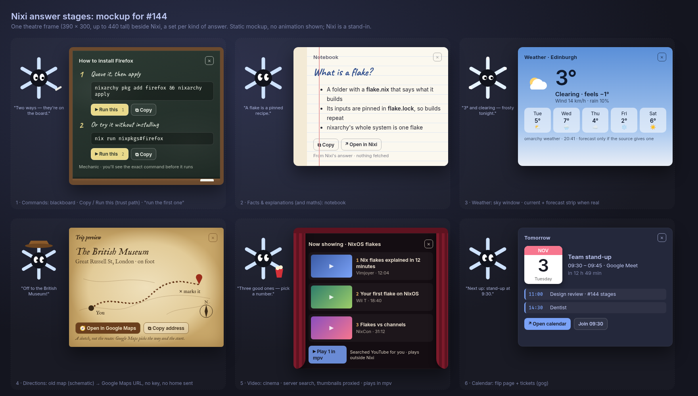

# Spec: A visual stage for each kind of answer



The mockup ([HTML](2026-11-02-144-answer-stages-mockup.html)) is static, and its
Nixi is a stand-in. Code paths below are in `olafkfreund/nixoarchy-snowflake`
at `f65f587`.

## Design

### 1. One theatre, several sets

- **One stage frame** beside Nixi: 390 × 300 px, growing to at most 440 tall,
  then scrolling inside. It sits on the side with room, is clamped to the
  monitor, and follows Nixi only when you move him.
- The frame grows the window the way the mail pop-out and terminal sheet do,
  as a third size request in `sizeWindow()` (`app/static/index.html:2709`). The
  area beside Nixi is click-through while the stage is closed (input shape,
  `app/window.py:1062-1074`).
- Every set shares:
  - a title plaque, top left;
  - a ✕ button and Esc, top right;
  - numbered items `1 2 3`, so you can use them by voice;
  - one action row at the bottom.
- The set changes the **material**, not the layout. One CSS class on the frame
  picks it:

| Set | Material | Used for |
|---|---|---|
| `board` | Chalk slate, wooden ledge | Commands |
| `notebook` | Ruled paper | Facts, explanations, maths, links |
| `sky` | Day/night gradient | Weather |
| `cinema` | Velvet curtains, dark screen | Video |
| `map` | Parchment, ink, compass | Directions and places |
| `desk` | The Omarchy theme panel | Calendar, sessions, system status |

- **Text never goes into chalk or ink fonts.** Commands are always in the
  monospace font, so they're exact and easy to read. A hand-lettered font is
  used only for headings and labels. The two fonts are OFL-licensed (Caveat,
  IM Fell English) and ship as `app/static/fonts/*.woff2`, so the page never
  contacts Google.
- Frame, text and accent colours come from the theme variables
  (`index.html:11`). Slate and parchment keep their own surface colour but take
  the theme's accent for borders and buttons.

### 2. How a stage is chosen: a typed block, never guessed from prose

- **Agent-made stages** (commands, facts) are requested in the spoken-reply
  note in `run_bridge()` (`app/server.py:3811`). The note asks the agent, when
  the answer has commands or more than one point, to end its reply with one
  line:

  ```text
  <<stage>>{"v":1,"kind":"commands","title":"…","items":[{"label":"…","cmd":"…"}]}
  ```

- **Server-made stages** need no data from the agent's prose. The agent only
  says what to show, and the server fetches it:

  ```text
  <<stage>>{"v":1,"kind":"weather"}
  <<stage>>{"v":1,"kind":"video","query":"nixos flakes"}
  <<stage>>{"v":1,"kind":"place","dest":"British Museum, London","mode":"walking"}
  <<stage>>{"v":1,"kind":"calendar"}
  ```

- **The server cuts the block out of the stream** before the caption and the
  voice. It holds back text from `<<stage` onwards until the end of the line.
- **The server validates the block:**
  - known `kind`s only;
  - at most 5 items;
  - labels up to 120 characters, commands up to 500;
  - no control characters;
  - URLs built only by the server.

  A block that fails is dropped and the answer stays a caption.
- **The page receives a `t:"stage"` event** with the validated content and
  renders every field with `textContent`, never as HTML.
- **Each command and link gets a server-held token.** The page sends back only
  `{token}`, never command text. The server keeps the current stage, plus the
  one before it, for 10 minutes.

### 3. "Run this": the existing trust path, made exact

- **The click goes through the bridge, as a send to a session does.** Clicking
  **Run this**, or saying "run the first one", makes the server look up the
  command by its token. It then sends the bridge a prompt in the same form
  already used for sending text to a herdr session (`app/server.py:3791`):

  ```text
  Run exactly this one command and nothing else: <cmd>
  ```

  The bridge then applies the trust level, as for any tool:

  | Trust level | What happens |
  |---|---|
  | Guide | Cancels it. The board shows "Guide doesn't run commands — switch to Mechanic", and Run is greyed out while Guide is on. |
  | Mechanic | Shows the approval card with the full command. |
  | YOLO | Runs it, except that secret paths are still refused. |

- **Byte-exact check:** in `run_bridge()`'s permission handler (`approve()`,
  around `server.py:3803`), a permission request during a stage-run is compared
  with the stored command. If it differs, it's **denied automatically** and the
  board says "Nixi tried to run something else — stopped."
- **Status shows under the command:**
  - waiting for approval → running → ✓ done, or ✕ failed with its first error
    line;
  - full output goes to Nixi's existing "Open in Nixi" view;
  - the board never fills up with logs.
- **Copy** writes the exact command with `wl-copy`, through a server route. It
  works at every trust level.

### 4. The sets, in order of shipping

#### Slice 1: fixes the bug and lays the foundation

- **Board (commands).**
  - Numbered steps: a hand-lettered label, the command in monospace, then
    **Run this** and **Copy**.
  - It also answers "which package gives me X?" and "search options for Y":
    those are commands too, such as `nixarchy search`.
  - The spoken reply stops saying "the command on screen" when no stage
    opened. S24's pointer phrase is used only when the board is actually
    showing.
- **Notebook (facts).**
  - A heading, up to 5 short points, and an optional source line.
  - **Copy** and **Open in Nixi**.
  - Maths and conversions use the notebook only when there's more than one
    line; a single result stays in the caption.

#### Slice 2: the hand-offs

- **Map (directions and places).**
  - **The map is a sketch, labelled as one:** "Trip preview" on parchment, with
    the destination name, an inked trail from "You" to an ✕, and a compass
    rose.
  - It gives no streets, distance or travel time. The footnote says "A sketch,
    not the route: Google Maps picks the way and the start."
  - **Open in Google Maps** opens `https://www.google.com/maps/dir/?api=1&destination=…&travelmode=…`
    in your browser (`xdg-open`). A place without a route uses
    `/maps/search/?api=1&query=…`.
  - No API key is needed, no origin is sent, and the page makes no request.
  - **Copy address** is the second button.
- **Cinema (video).**
  - The agent sends `query`. The server runs
    `yt-dlp --flat-playlist -J "ytsearch3:<query>"` with an 8 s timeout and
    keeps the title, channel, duration and URL of each result.
  - Thumbnails are fetched by the server (3 at most, up to 200 KB each, only
    from `i.ytimg.com`) and served same-origin.
  - **Play** starts `mpv <url>`, a separate window. If mpv is missing, it
    opens the browser instead.
  - The footer says "Searched YouTube for you · plays outside Nixi".

#### Slice 3: what Nixi already knows

- **Sky (weather):**
  - current conditions, from `omarchy weather`, which `Ambient` already reads;
  - a forecast strip only if the source returns one, never made up;
  - the source and the time are shown.
- **Desk (calendar):**
  - the next event as a flip page;
  - up to 3 more as tickets;
  - **Open calendar**;
  - **Join** when the event has a meeting link.
- **Desk (status):**
  - herdr sessions and failed user services as rows marked ok/warn/fail;
  - **Open session** or **Open terminal**;
  - only checks that actually ran are listed, with no overall "all healthy".

#### Slice 4: my day (Amendment 1, see below)

- **Desk (day):** "How does my day look?" or "what's next today?" opens the day
  desk. Its design is in [Amendment 1](#amendment-1-slice-4-the-day-desk).

#### Not stages

- **Timers** stay a small prop with a notification.
- **Music** keeps its headphones.
- **The screen look** keeps the caption.
- **Short facts**, under about 20 words with nothing to act on, keep the
  caption.

### 5. Motion: fun that never waits on you

The content is readable from the first frame. Animation decorates what is
already there and never reveals it.

| Beat | Time | Stage | Nixi |
|---|---|---|---|
| Open | 220 ms | Unfolds from his side (scale 0.9 → 1, fade) | Turns toward it, puts on the set's prop |
| Flourish | ≤ 650 ms, once | Chalk underline, ink trail, curtains part, page flips | The set's gesture: chalk, explorer hat, popcorn, pocket watch |
| Point | 300 ms | The first item's button glows once | Points at item 1 |
| Idle | — | Still: no loops | Normal idle, glancing at the stage now and then |
| Close | 180 ms | Folds back to him | Puts the prop away |

- **GPU safety:**
  - only `transform`, `opacity` and `stroke-dashoffset` are animated;
  - no WebGL or WebGPU;
  - no `backdrop-filter`;
  - no SVG `feTurbulence` or displacement filters (the mockup's ink wobble is
    one, and it won't ship);
  - paper and chalk grain are a small static pattern.
- **`prefers-reduced-motion`:** stages appear and disappear with a fade, the
  flourish is skipped, and Nixi doesn't change costume.

### 6. Usability rules

- **Opening a stage.** A stage opens only when there's something to act on, at
  least two items to compare, or something spatial or time-based. Otherwise
  the caption is enough.
- **One at a time.**
  - A new stage replaces the old one.
  - "Go back", or a ← on the plaque, restores the previous stage for
    10 minutes.
  - An approval card always comes first: the stage dims while one is open.
- **How long a stage stays:**
  - **Stages with buttons** (board, map, cinema, desk) stay until you close
    them. After 30 s of no use they shrink to a small tab beside Nixi showing
    their title; click or say "show it" to bring them back.
  - **Read-only stages** (notebook, sky) close 20 s after Nixi stops speaking,
    or later if the pointer is over them.
  - **After a hand-off** (Maps, Play, Open), the stage shows "Opened ✓" and
    closes after 1.5 s.
- **Voice before the agent.** These phrases are matched by the server against
  the current stage, with no agent round-trip, so they're instant:
  - "run the first/second/third one", "copy that", "play number two";
  - "open it" (only if there's exactly one target; otherwise Nixi asks which);
  - "close", "go back", "show it".

  Running still goes through the bridge, as in §3.
- **Focus.** Opening a stage never takes the keyboard. Its buttons take focus
  only when clicked, as Nixi does today (`window.py:347`), and Tab then moves
  between them.
- **Quiet times.** Unasked-for stages never open (stages only answer a
  request), and none open during fullscreen, lock, dictation or an approval.

### 7. Settings

One setting, **Answer stages** (on by default, under Voice). When it's off,
everything stays a caption and the spoken-reply note doesn't ask for a block.

## Alternatives rejected

- **A separate prop per request (13 designs).** Too much to keep alive in one
  page. Both reviewers merged them into a few sets.
- **The page guesses a stage from the answer's prose.** Fragile, and it could
  turn any text into a Run button. A typed block, validated by the server, is
  the only way a stage opens.
- **The board runs the command itself**, through a shell route in the server.
  That would bypass nixi's trust levels. The bridge path keeps Guide, Mechanic,
  YOLO and the secret rules exactly as they are.
- **A Quickshell pop-out in nixi's card** (the user's first idea). It would
  split the answer from Nixi and duplicate the work. The card's "Open in Nixi"
  link already covers long output.
- **Real route geometry from OpenStreetMap (Nominatim + OSRM).** agy preferred
  it, because a decorative trail can point the wrong way. Codex and I chose the
  sketch for now:
  - it sends no address anywhere;
  - it needs no rate limits or caching;
  - it can't look more accurate than it is.

  An opt-in "Draw real routes (sends the addresses to OpenStreetMap)" can come
  later without changing the stage.
- **Inline video or an embedded map.** GPU and privacy risk inside the window
  that crashed Hyprland. Playback and maps hand off to mpv or the browser.
- **Auto-closing a board after 45 s** (agy). That could pull a command away
  while you're still reading it. It shrinks to a tab instead.

## Risks

- **The agent forgets or garbles the block.** The answer stays a caption, which
  is today's behaviour. Validation drops anything malformed.
- **Prompt injection through video titles, place names or service names.**
  These are text nodes only. Tokens are made only for command blocks from the
  agent's own reply and for URLs the server built, never from fetched data.
- **"Run this" runs something else.** The byte-exact check denies any other
  command during a stage-run.
- **yt-dlp breaks when YouTube changes.** The cinema shows "Couldn't search
  right now" with **Search in browser**.
- **Window growth** on a small monitor: the stage is clamped to the monitor and
  flips to the side with room.
- **GPU:** the bans in §5. Previews are tested in headless, GPU-free Chromium
  only, and the kernel log is checked for `ring timeout` or `gpu reset` after
  each one.
- **Hosts:** p620 only, for the live checks.

## Verification

- **Unit tests** (`python3 -m unittest`):
  - block extraction from a streamed reply, including a block split across
    deltas;
  - validation: kinds, limits, control characters;
  - token lookup and expiry;
  - the byte-exact deny;
  - the voice fast-path phrases;
  - the Google Maps URL encoding;
  - the yt-dlp result parsing, from a saved fixture;
  - thumbnail size and host limits.
- **Page test** (headless, GPU-free, the `accessories_fit.mjs` pattern):
  - each set renders from a fixture event;
  - the frame stays inside a 2560×1440 monitor;
  - no field becomes HTML (a `<b>` in a title shows as text);
  - reduced motion skips the flourish.
- **Live on p620:**
  - "how do I install firefox?": the board shows the commands;
  - Run in Guide: refused;
  - Run in Mechanic: the approval card shows the exact command, and Deny leaves
    nothing run;
  - "directions to the British Museum": Google Maps opens in the browser;
  - "show me a video about nix flakes": the cinema lists results, and Play
    opens mpv;
  - "what's the weather?": the sky stage;
  - Esc and "close" dismiss each stage;
  - typing in another window is never interrupted.
- **Reviews:** a fresh Opus review of each slice's diff, plus Codex and agy
  (`reviewers:` in the plan).

## Amendment 1: slice 4, the day desk

Status: **approved** (2026-11-02). Slices 1–3 above stay approved. The user asked for this on
2026-11-02 ("How does my day look? or what is next for today… my task and my
github issues"), and Codex and agy reviewed the design (agy critiquing Codex).

### Design

- **What opens it:**
  - "how does my day look?", "what's next today?" or "what's on today?" sends a
    `{"v":1,"kind":"day"}` block, so the server builds the stage;
  - Nixi's own phrase list catches the exact "what's next?" without an agent
    turn.
- **Layout:** the `desk` set, in the same frame.
  - A paper **date tab** at the top, with today's date.
  - **Next:** one highlighted card with the next event's time, its title, "in
    40 min", and **Join** when it has a meeting link.
  - Three compact rows, each with a count and at most two titles:
    - **Today:** the rest of today's events, including all-day ones.
    - **Tasks:** tasks due today, plus overdue ones marked in red.
    - **GitHub:** issues assigned to you and pull requests waiting for your
      review, each shown as `repo#n title`.
  - Clicking a row opens it in the same frame, at most 8 items. Clicking an
    item opens it in the browser, through a server-built URL token as in §3.
- **Data, fetched on the server when the stage opens:**

  | Source | Command | Notes |
  |---|---|---|
  | Calendar | `gog --readonly --json calendar events <ids> --from <today 00:00> --to <tomorrow 00:00>` | The calendars `Ambient` already uses (`server.py:1098`), but the whole local day, including all-day events |
  | Tasks | `gog --readonly --json tasks list <list> --due-max <tomorrow 00:00>` | Every list from `gog tasks lists`, up to 3 lists; not completed |
  | GitHub | `gh search issues --assignee=@me --state=open --json repository,number,title,url -L 8`, and `gh search prs --review-requested=@me --state=open …` | Only when `gh auth status` succeeds |

  - Each source runs on its own, with an 8 s timeout and a 5-minute cache.
  - A source that fails or isn't set up shows its row as "not set up" or
    "couldn't refresh · 10:42". The last good data stays, marked stale. A
    snapshot from yesterday is never passed off as today's.
  - **Mail:** at most an unread count, and only if a source is already set up.
    No subjects.
- **Voice:**
  - the exact "what's next?" is answered at once from the snapshot, speaking
    only the next item;
  - any other question asked while the desk is open goes to the agent with a
    short summary of the snapshot attached: counts and the top two titles per
    row, about 150 tokens;
  - opening an item by voice ("open the second issue") is left for later. In
    v1 you click.
- **Privacy:**
  - titles are never written to logs, notifications or history;
  - the snapshot lives in memory only;
  - nothing goes to the agent unless you ask a question.
- **Nixi's gesture:** a pocket watch. The flourish is a single page flip of the
  date tab.

### Alternatives rejected

- **Sending the whole day to the agent every time.** Slow, and it uses tokens
  just to view. Viewing happens on the server; only questions go to the agent.
- **Voice-numbered opening in v1** (Codex). It needs a stable mapping from
  numbers to IDs that survives refreshes. Click first (agy).
- **A mail dashboard.** Too much privacy exposure for a glance.

### Risks

- **gog or gh missing, or not signed in:** that row says "not set up", and
  nothing else breaks.
- **Many events or issues:** each row shows two titles and a count; the detail
  view shows up to 8.
- **Time zones and all-day events:** the day is your local midnight to
  midnight, and all-day events show as "all day".

### Verification

- **Unit tests:** fixtures for gog calendar, gog tasks and gh JSON. They check
  the local-day window including all-day events, overdue marking, a stale row
  on failure, URL tokens, and the "what's next?" fast path.
- **Page test:** the day desk fits the frame, with empty, full and stale
  fixtures.
- **Live on p620:** "how does my day look?" shows your real calendar, tasks and
  GitHub; clicking an issue opens it in the browser.
