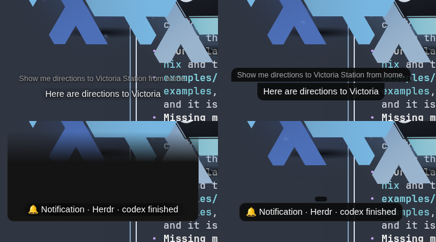

# Spec: Nixi's captions and notification card are readable over any window

All changes are in the companion page, `app/static/index.html`
(nixoarchy-snowflake). Line numbers are at `main` `9076c04`.

## What's there today (checked)

- **Markup** (`:654`): `

`,
  then `

`.
- **`#cap`** (`:165`):
  - a fixed box: `top: 296px`, `height: 100px`, full width (`left` and
    `right` at 12 px);
  - flex column, aligned to the bottom;
  - no background, a `text-shadow` only;
  - a top-fade `mask-image` (34%).
- **`#you`** (`:258`): 12 px, `var(--dim)`, a lighter shadow.
- **`#him`** (`:270`): 14.5 px, `width: 100%`, `max-height: 4.5em`,
  `overflow: hidden`.
- **`#wk`** (`:257`): 11 px mono, `var(--dim)`, no shadow.
- **Notifications** add the class `note` to `#cap` (`:1928`). That pulls in
  the panel's `.note` list-item box (`:397`: grey background, border,
  padding and radius), and the mask fades it: that's the grey half-box.
  `sendRegion` then makes all of `#cap` clickable (`:3013`,
  `add(cap,4)`).
- **Theme colours** come from the Omarchy theme (`:880`): `--panel` is the
  theme background, `--text` the foreground, and `--dim` is
  `dark_foreground` or `muted` or the foreground. So `--dim` against
  `--panel` can be any contrast.
- **Notch (bar) mode** (`:114-120`) clears background, mask and shadow on
  `#cap`. It stays out of scope, as the intent says.

## Design

### 1. One plate that hugs the caption

- **New wrapper:** `#you` and `#him` go inside a new `
`
  inside `#cap` (`:654`).
- **The plate:**
  - `width: fit-content`, `max-width: 100%`, centred by `#cap`'s existing
    `align-items: center`;
  - `padding: 5px 11px`, radius 12 px;
  - `background: var(--cap-bg)` (§2).
  - **One shape, one width.** Both lines live in the same box, so there are
    no separate corners to match up and no mismatched widths. "You said" is
    the plate's small first line.
- **Empty means invisible:** `#plate` is hidden while both lines are empty,
  `#you:empty` takes no space, and the page never draws an empty backing.
- **The shadow goes:** `#cap`'s `text-shadow` (`:168`) and `#you`'s own
  shadow (`:258`) are removed, because on a backing a shadow only blurs the
  letters.
- **The mask goes:** `#cap`'s top-fade `mask-image` (`:167`) is removed,
  because it would fade the plate.
  - Older karaoke lines are still cut by `#him`'s `max-height` and
    `overflow: hidden`.
  - `#him`'s `max-height` stays `4.5em` on its own content: the padding is
    on `#plate`, not on `#him`, so no line is lost and nothing shows in the
    padding.
- **No word-by-word jumps.** A `fit-content` width follows each streamed
  word (`karaPut` `:1652`, `showHim` `:2095`), and CSS can't animate that.
  So the plate's width only grows during a caption:
  - after each word, the page sets `#plate.style.minWidth` to the larger of
    the current `minWidth` and the plate's natural width;
  - a new caption (`himSet`, a new notification, a nudge) resets it.
  - The plate then widens a little at a time as a line fills, never
    shrinks mid-caption, and once a line wraps it stays at full width.
    `min-width` is transitioned over 0.15 s.
  - Under `prefers-reduced-motion` there's no transition.

### 2. Colours that pass over black and over white

- **`contrast(a, b)`:** a new helper of about 10 lines, next to `shade()`
  (`:880`), using the WCAG relative-luminance formula on hex colours.
- **`over(c, a, bg)`:** a helper that composites colour `c` at alpha `a`
  over `bg`, to get the real colour on screen.
- **When the theme is applied** (`applyThemeVars`, `:878`), and once at
  start for the default theme:
  1. **Backing opacity:** start at `a = 0.90`. The two possible real
     backings are `over(--panel, a, #000)` and `over(--panel, a, #fff)`.
  2. **For each text colour** (`--text`, the dim colour for "you said" and
     `#wk`, the error red and the code tint):
     - try `mix(c, best, t)` for `t = 0, 0.1, …, 1`, where `best` is
       whichever of black or white contrasts more with `--panel`;
     - take the first `t` whose contrast is at least 4.5:1 against **both**
       real backings.
  3. **If even `best` fails at `a = 0.90`,** raise `a` by 0.02 at a time up
     to 1.0 and repeat. At `a = 1` the backing is `--panel` itself, and
     black or white always reaches at least 4.5:1 against any opaque
     colour.
  4. Set `--cap-bg`, `--cap-text`, `--cap-dim`, `--cap-err` and
     `--cap-code`.
- **With the default and Omarchy themes,** `t` stays at 0 for the main text
  (the colours are unchanged), and "you said" moves only as far as needed.
- **Sizes:** `#him` stays at 14.5 px and weight 500. `#you` goes to 12.5 px,
  in normal and full-text mode alike (`:262` already uses 12.5 px).

### 3. The notification card

- **Rename the class** set on `#cap` from `note` to `ntf`, in three places:
  where it's added (`:1928`), where it's removed (`:2082`), and in
  `sendRegion` (`:3013`). The CSS selector `#cap.note` (`:256`) is
  rewritten as described next. The panel's `.note` rule then no longer
  applies to the caption, and the grey half-box is gone.
- **Only the card takes clicks:**
  - `#cap.ntf #plate { pointer-events: auto; cursor: pointer }` replaces
    `#cap.note` (`:256`), so `#cap` itself stays click-through in the DOM,
    whether click-through is on or off;
  - the click listener moves from `cap` to `#plate` (`:2085`);
  - `sendRegion` adds `#plate`'s box instead of `#cap`'s (`add(plate, 4)`).
- **The card's look:** while `ntf` is set, the plate gets a 1 px
  `var(--line)` border.
- **A notification replaced early** (by `himSet`, or a nudge before its
  timer ends) goes through `notifyClear` first, so `ntf` never outlives its
  text.

### 4. The nixi-mode status line (`#wk`)

- **Its own small pill,** with the same `--cap-bg` backing:
  - `width: fit-content` and `margin: 0 auto`;
  - `padding: 2px 8px`, radius 999 px;
  - colour `--cap-dim`, size 11.5 px, still mono and single-line with an
    ellipsis.
- **`#wk:empty { display: none }`.**

### 5. Notch (bar) mode stays one shape

The notch rule (`:114-120`) clears `#cap`'s own background, but not its
children's. Add overrides:

- `body.bar #plate` gets `background: none`, `border: 0`, `padding: 0`,
  `min-width: 0`;
- `body.bar #wk` gets `display: none`, as it isn't shown in the notch
  today either;
- `body.bar #cap.ntf #plate` has no border.

### 6. What stays the same

- **Full-text mode** keeps its taller box; the plate holds more lines.
- **Fading in and out** (`#cap.off`) is unchanged, so the plate fades with
  the text.
- **The word and "you said" entrance animations** (`:259`, `:273`) are
  unchanged.
- **The "answering · 0:09" chip** is unchanged.

## Preview

A prototype made by injecting the CSS into headless Chromium with the GPU off,
over a screenshot of a terminal on p620. Left is today, right is the
proposal.

The prototype used two backings, one per line. It showed both problems the
reviews predicted:

- the two lines had different widths;
- an empty element drew a small pill above the notification.

The single `#plate` in §1 fixes both.

## Review (Codex and agy, both read-only)

Both found the same core holes in the first draft, and this version fixes
them:

- **The contrast margin didn't hold over white.** It's now checked against
  both real backings, with opacity raised per theme if needed.
- **The dim-colour loop couldn't reach its target.** It now interpolates
  properly towards black or white.
- **Notch mode would have got plates inside the notch.** There are now child
  overrides.
- **`fit-content` jumps word by word.** The width now only grows within a
  caption.
- **The DOM click target stayed the full `#cap` box,** and `#cap.note` at
  `:256` was missed. Clicks now go to `#plate` only.
- **Padding would have clipped the third line.** The padding now goes on the
  wrapper.
- **`#you`'s own shadow and the full-text `#you` rule** were missed. Both are
  now covered.

## Alternatives rejected

- **One big plate the size of `#cap`.** That would be a 100 px dark box even
  for a one-word caption. `#plate` hugs the text instead.
- **A separate backing per line, like subtitles.** The prototype showed
  mismatched widths and an empty pill. One wrapper is simpler.
- **Checking contrast against `--panel` alone with a margin.** The reviews
  showed that a 4.8:1 margin can drop to about 3.9:1 once the backing is
  blended over white. Checking against both real backings is exact.
- **A stronger `text-shadow` or a stroke on the letters.** It's still
  unreadable over busy text, and it looks heavy.
- **`backdrop-filter: blur()`.** Ruled out: it hung the GPU on p620 before.
- **A fixed dark colour instead of `--panel`.** It would clash with light
  themes, which get a light backing with dark text this way.
- **Leaving the `.note` class and overriding its styles on `#cap`.** That
  couples the caption to a list-item style again. A separate class name is
  cleaner.

## Risks

- **A theme with a very transparent or odd `--panel`:** `color-mix` keeps
  the theme's own opacity, multiplied by 90%. In practice the Omarchy
  themes use opaque backgrounds.
- **The plate widening as words stream in:** it only grows, a little at a
  time, within one line. If it still feels busy live, we can widen it to the
  full caption width as soon as a line passes half-width (a deviation).
- **WebKitGTK (the real window) and `color-mix`:** `color-mix` is already
  used on the page (`#chip`, `#ask`), so WebKitGTK supports it.
- **Hosts:** p620 and razer, the usual deploy.

## Verification

- **A contrast unit test** (`tests/caption_contrast.mjs`, run by a Python
  wrapper like the others):
  - for the default theme, a light Omarchy theme, a theme whose
    `dark_foreground` is nearly the background, and a mid-grey `#727272`
    panel (the case the reviews found);
  - apply the theme and read the computed `--cap-bg` alpha and the four
    text colours;
  - assert each colour is at least 4.5:1 against the backing composited over
    pure black and over pure white.
- **The page test** (`stages_fit.mjs` or a new caption fit test, GPU-free
  headless):
  - `#plate` has a background and hugs a short caption: it's narrower than
    `#cap`;
  - with both lines empty, nothing draws;
  - `#cap` has no `mask-image` outside notch mode;
  - a notification sets `ntf`, not `note`; `#plate` has a border, and a
    click on `#cap` outside the plate does nothing;
  - the region sent includes `#plate`'s box, not `#cap`'s full box;
  - streaming 12 words never makes `#plate` narrower between words;
  - a three-line caption shows all three lines, unclipped;
  - `#wk:empty` shows nothing;
  - notch mode: `#plate` has no background and no padding, and `#wk` is
    hidden.
- **Before and after previews** in headless Chromium with the GPU off:
  - over a screenshot of a busy terminal, for a short answer, a three-line
    answer, "you said" plus an answer, a notification, and `#wk`;
  - in the dark and light themes;
  - `journalctl -k` checked after each.
- **Live on p620,** after deploy:
  - ask something over a terminal, and trigger a notification;
  - check `journalctl -k` for GPU resets.

## Open questions

1. **The backing strength:** 90% `--panel` is my suggestion. The contrast
   rule raises it per theme when needed. 95% is nearly opaque; 85% shows
   more of the desktop.
