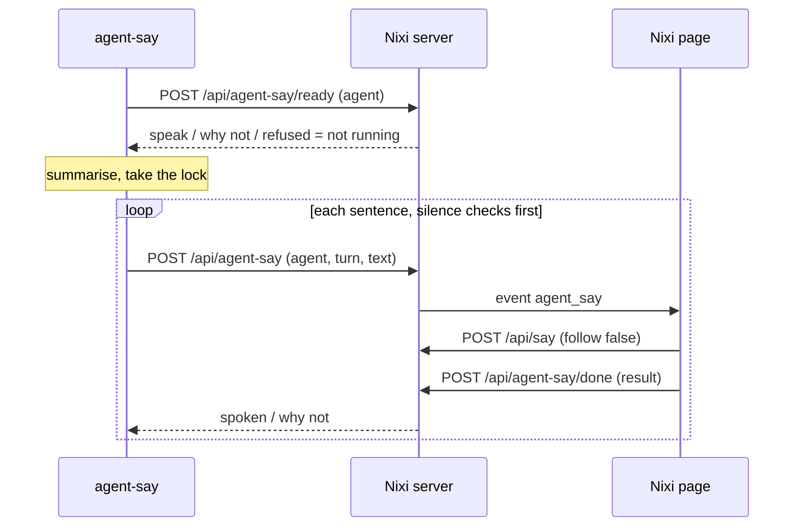

# Spec: Agent turn summaries spoken by Nixi

## Design

`agent-say` keeps the hooks, the summariser and the silence checks. It hands
Nixi one sentence at a time and waits for each to finish. Nixi's page speaks it
through the queue it already uses, so captions, lip-sync, mute and stop all work
without new speech code.

### Nixi: `app/server.py`

- `POST /api/agent-say/ready {from}` returns `{speak: true}` or
  `{speak: false, reason}`. Reasons: `muted-agent`, `hidden` (`Wake.asleep`),
  `meeting` (`Ambient.meeting`), `cap`, `no-voice`. With no page connected
  (`BUS.subs` empty) it returns `{running: false}`.
- `POST /api/agent-say {from, turn, text, speak}`:
  - validates `from` as `claude|codex|agy`, `turn` with the existing id pattern,
    and `text` up to 600 characters; a line matching `SECRET_LINE` is refused;
  - repeats the `ready` checks;
  - publishes `agent_say {id, from, name, turn, text, speak}`;
  - waits on a per-request event for the page's answer, for at most 30 s, on its
    own server thread (`ThreadingHTTPServer` is already in use);
  - returns `{spoken: bool, reason}`. A timeout returns `reason: "timeout"`.
  - `speak: false` only adds the summary to replay, with no speech.
- `POST /api/agent-say/done {id, spoken, reason}`: full token only, as the page
  sends it.
- `POST /api/agent-say/more`: full token only; starts `agent-say more` with no
  shell, if it's on `PATH`. The result comes back through the same path.
- `/api/agent-say` and `/ready` join `TOOL_PATHS`. `agent-say` reads `tool_token`
  from `runtime.json`, never the full token.
- New setting `agent_voice_mute`: a list drawn from the three agents.

**The cap and voice changes:** `speak_sentence` silently drops to the local engine
when the cap is reached, which breaks "never another voice". `ready` and
`/api/agent-say` therefore check first, with a new read-only
`eleven.can_reserve(n, cap)`, `eleven_why()` and `_eleven_sticky`. A failure on a
sentence already in flight can still use the local engine once; the next sentence
is then refused. Nothing else about `speak_sentence` changes.

### Nixi: `app/static/index.html`

On `agent_say`:

- `hiddenNow`: answer `hidden`.
- `busy`, `playing`, `rec` or a pending approval: answer `busy`. Summaries wait
  for silence, so they never cut into his own speech or work, and stopping one
  can't cancel a turn of his.
- `muted`: show the caption and answer `muted`.
- Otherwise `restore(11000,false)`, `comeBack()` in hover mode and
  `enqueue(text,{follow:false,cap:true})`, as the finished alert already does for
  waking him. Idle-hide pops back this way.
- The answer goes back on `spk_done`, `spk_skip`, or when he's cut off.
- Every summary is kept per `turn` in a page array of the last 5, memory only.

**Settings → Voice** gets an "Agents" row: one switch per agent, the last 5
summaries with Replay, and "Tell me more" on the newest. Replay uses
`enqueue(text,{follow:false,cap:true})`. Strings follow whatever #177 has merged
by then.

**Finished alert:** the existing `attention` hook stays as it is and fires when
the turn ends. The summary comes later with no badge or chime of its own, so each
turn has one alert. Short turns only ever get that alert.

### `pkgs/agent-say/agent_say.py` (nixos_config)

- `config.speaker`: `"nixi"` or `"agent-say"`, default `"agent-say"`.
- **Before summarising:** check `held(cfg)`, then `ready`. If he's running and says
  no, log it and stop: no summariser call.
- **Falling back:** only when `ready` shows he isn't running: no `runtime.json`,
  connection refused, HTTP 404 (an older Nixi) or `running: false`. That decision
  is made once per turn, before the first sentence. No failure after that point
  uses the old voice, so a turn is never spoken twice.
- **`busy`:** retry every 2 s for up to 120 s, holding the lock.
- **The lock:** in Nixi mode wait for it for up to 120 s instead of skipping.
  Giving up sends `speak: false`, so the summary can still be replayed.
- **Each sentence:** `held(cfg)` first, as `say_gated` does today. A summary
  queued behind another is checked again the same way, so Nixi needs no copy of
  these checks.
- **Payload race:** the hook writes `last-<agent>-<turn>.json` and passes `turn` to
  the worker, which deletes it after reading.
- **`offer_more`:** skipped when Nixi spoke.
- `last-summary.json` stays one file, so "Tell me more" covers the newest turn only.

### `modules/programs/agent-voice.nix`

- `features.agentVoice.speaker = enum [ "agent-say" "nixi" ]`, default
  `"agent-say"`, written to `/etc/agent-say/config.json`.
- p620 and razer switch to `"nixi"` in one commit after the live check.
- Hooks, keys and summariser settings don't change.

### Order

1. `fix/176-same-lily` lands.
2. Nixi, deployed with the setting still off. Older `agent-say` doesn't call it.
3. `agent-say` deployed with `speaker = "agent-say"`: no behaviour change.
4. Live check on p620 by one host's setting, then razer.

## Alternatives rejected

- **Folder plugin:** sandboxed, no localhost, killed after 8 s at most.
- **Server calls `Speaker.say` directly:** the page drops `spk` events for ids it
  didn't queue (`index.html:2167`), so there would be no captions or face, and the
  server can't see the page's mute.
- **Summariser and hooks move into Nixi:** ties Nixi to three transcript formats and
  loses a tested tool, and hosts without Nixi would lose summaries.
- **Nixi copies the silence checks:** two copies drift. Asking `agent-say` to check
  before each sentence keeps them in one place.
- **A queue inside Nixi:** the lock with a deadline does the same job in far less code.
- **Reuse `/api/attention`:** it's rate-limited to one per 30 s and is designed not to talk.
- **The full window token, as `nixi-companion attention` uses:** the intent rules it
  out for this path.

## Risks

- **Any program holding `tool_token`, including commands his own Claude runs, can
  make him say up to 600 characters.** Bounded by validation and the daily cap. He
  already speaks that Claude's output, so this is accepted.
- **He wakes for summaries** after idle-hide. Turns under 60 s stay silent, and he's
  silent in meetings and when hidden. Mute per agent if it's too much.
- **Several sessions can queue for up to 120 s,** so a summary can come late. Past
  that it's replay only.
- **A hung page holds a sentence for 30 s,** then that turn stops. Nothing is
  spoken twice.
- **Daily cap:** summaries now count against Nixi's cap, as approved.
- **Page TTS mode** (`voice_out: page`): the page path handles it, but it needs its
  own test.
- **Conflict with other work:** `index.html` is shared with #177 and #178, and
  `eleven.py` with `fix/176-same-lily`.

## Verification

Agy's concern that the microphone reopens looks unfounded: `Wake.talking_until`
with `follow` false clears the follow-up window (`server.py:2964-2970`), and
`FLOOR.release` only releases the audio floor. A test settles it.

**Unit tests, Nixi** (under `_ServerEnv` only, and never importing `server` outside it):

- `ready` for each reason; no page gives `running: false`;
- the tool token reaches `/api/agent-say` but not `/done` or `/more`, and can't
  reach `/api/say`;
- bad `from`, `turn` and over-long text are refused, and so is a secret line;
- a 30 s timeout, with a shortened clock, returns `timeout`;
- cap reached: no `/api/say`, `reason: "cap"`;
- `follow: false`: `Wake.can_follow` stays false after speech.

**Page tests** (headless, `--disable-gpu`): each branch answers correctly; a muted
summary gets a caption and no speech; the alert isn't repeated; replay holds 5,
with nothing in `localStorage`.

**Unit tests, `agent-say`** (`test_agent_say.py`):

- connection refused, 404 and `running: false` use the old voice;
- `hidden` and `muted-agent` give no summariser call and no old voice;
- a failure after sentence 1 never uses the old voice;
- a Do Not Disturb starting mid-summary stops before the next sentence;
- two workers for one agent read their own payload files;
- `speaker = "agent-say"` is byte-for-byte today's path.

**Live on p620:**

- a real Claude turn over 60 s: Lily, face and captions, one alert;
- Esc during it stops the speech;
- hidden, silent; idle-hidden, pops back and speaks;
- stop Nixi: the old voice speaks;
- a call: silent;
- switch back to `speaker = "agent-say"` and confirm today's behaviour.
