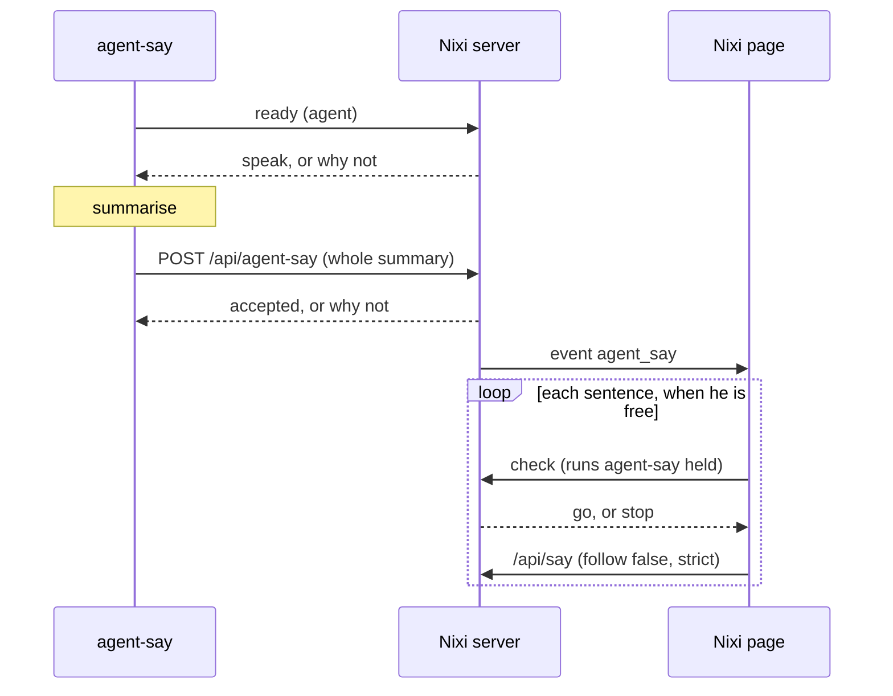

# Spec: Agent turn summaries spoken by Nixi

## Design

`agent-say` keeps the hooks, the summariser and the silence checks. Once it has a
summary, it hands the whole text to Nixi once and exits. From then on Nixi's page
owns it: the queue, each sentence, stopping and replay. A turn is decided once, so
it can't be spoken twice or by both voices.

### Nixi: `app/server.py`

- `POST /api/agent-say/ready {from}`: `{speak: true}`, or `{speak: false, reason}` for
  `muted-agent`, `hidden` or `meeting`. These are the cases where the summary needn't
  be written. A cap problem isn't one, because that summary still shows as text.
- `POST /api/agent-say {from, name, turn, text, kind}`, returning at once:
  - `from` is `claude|codex|agy`, `kind` is `short|more`, `name` up to 80 characters,
    `text` up to 2000, and a line matching `SECRET_LINE` is refused;
  - repeats the `ready` checks, and with no page connected (`BUS.subs` empty) answers
    `reason: "no-page"`. He's still running, so that's silence, not the fallback;
  - otherwise publishes `agent_say` and returns `{accepted: true}`.
- `POST /api/agent-say/check`: full token only. Runs `agent-say held` with no shell and
  a 3 s timeout; anything but exit 0 means stop, so it fails closed.
- `POST /api/agent-say/more`: full token only. Starts `agent-say more` with no shell.
- `/api/agent-say` and `/ready` join `TOOL_PATHS`. `agent-say` reads `tool_token` from
  `runtime.json`, never the full token.
- New setting `agent_voice_mute`: a list drawn from the three agents.

**Never another voice:** `/api/say` takes `strict: true`, carried through `Speaker.say`
into `speak_sentence`. At every point where the engine would change (cap,
`bad_voice`, the sticky error, `eleven_on` off, a queued item rewritten by
`cut_cloud`), a strict sentence publishes `spk_skip` with its `sid` and isn't spoken.
No read-only cap check is needed: the existing `eleven.reserve` decides.

**Speech that ends silently:** `Speaker.say`'s epoch drop and `_maker`'s
`made is None` publish `spk_skip` for a strict `sid`. Without this a dropped sentence
leaves `playing` stuck.

### Nixi: `app/static/index.html`

A page-only queue of up to 3 summaries; beyond that the oldest isn't spoken but stays
in replay. Any summary not started within 120 s also goes to replay only.

**On `agent_say`:** store it in the replay array (last 5, per `turn`, memory only,
nothing in `localStorage`), whatever happens next, then queue it.

**`agentNext()` before each sentence:**

- wait while he's busy: `busy`, `playing`, `rec`, `transcribing`, `pendingAppr` or
  `follow`, the same list as `notifyIdle()`, leaving out hover and fullscreen;
- `hiddenNow`: drop the queue;
- `muted`: show the caption, no speech;
- run `/api/agent-say/check`; on stop, drop the rest of this summary;
- `enqueue(sentence,{follow:false,cap:true,strict:true})`.

The sentence is finished when `playing` goes false, which works in both native and
page voice modes, so no id-based signal is needed. A 30 s guard calls `shush()` and
gives up on that summary, so a dropped event can't wedge him. `spk_skip` shows the
caption, so a reached cap stays visual.

**At the first sentence:** `restore()` for the length of the speech, `comeBack()` in
hover mode, and `agentMark(from,'done')`, so the mark shows who he's talking about, with
no chime or `tick()`. An idle-hidden Nixi may have popped up already for the finished
alert and pop up again here; that's accepted.

**Stopping:** while a summary is playing, click, Space and Esc call `agentStop()`, which
is `shush()` plus clearing the queue. It doesn't call `interrupt()`, so it can't post
`/api/stop` and doesn't go on to `startRec()`. Stopping speech doesn't cancel work and
doesn't open the mic. Anything you start yourself (typing, the wake word) ends the
summary the same way.

**Settings → Voice** gets an "Agents" row: one switch per agent, the last 5 summaries
with Replay, and "Tell me more" on the newest. Replay is `enqueue` with the same
options. Strings follow whatever #177 has merged by then.

**Finished alert:** the existing `attention` hook stays and fires when the turn ends, so
short turns only ever get that. The summary adds no badge or chime of its own.

### `pkgs/agent-say/agent_say.py` (nixos_config)

- `config.speaker`: `"nixi"` or `"agent-say"`, default `"agent-say"`.
- `deliver(cfg, agent, turn, who, name, text, kind)` replaces the direct call to
  `say_gated` in both `run` and `more`, so "tell me more" reaches Nixi the same way.
- **Before summarising:** `held(cfg)`, then `ready`. A refusal stops here: no summariser
  call.
- **Falling back:** only when `ready` finds he isn't running at all: no `runtime.json`,
  connection refused, or HTTP 404 (an older Nixi). Decided once per turn, before
  anything is handed over. Any later failure, such as a timeout or a 403, is logged and
  silent, so a turn can never be spoken twice.
- `agent-say held`: a new subcommand, exit 0 when clear, running today's checks. It's
  the one copy of them; Nixi only asks.
- **Payload race:** the hook writes `last-<agent>-<uuid>.json` with a fresh uuid per hook
  call, for all three agents, and passes it to the worker, which deletes it after reading.
- **`offer_more`:** skipped when Nixi took the summary.
- `last-summary.json` stays one file, so "Tell me more" covers the newest turn only.

### `modules/programs/agent-voice.nix`

- `features.agentVoice.speaker = enum [ "agent-say" "nixi" ]`, default `"agent-say"`,
  written to `/etc/agent-say/config.json`.
- p620 and razer switch to `"nixi"` in one commit after the live check.
- Hooks, keys and summariser settings don't change.

### Order

1. `fix/176-same-lily` lands.
2. Nixi deployed. Nothing calls the new endpoints yet.
3. `agent-say` deployed with `speaker = "agent-say"`: no behaviour change.
4. Live check on p620 by that host's setting, then razer.

## Alternatives rejected

- **Folder plugin:** sandboxed, no localhost, killed after 8 s at most.
- **Server calls `Speaker.say` directly:** the page drops `spk` events for ids it
  didn't queue (`index.html:2167`), so there would be no captions or face, and the
  server can't see the page's mute.
- **Summariser and hooks move into Nixi:** ties Nixi to three transcript formats and
  loses a tested tool, and hosts without Nixi would lose summaries.
- **Nixi copies the silence checks:** two copies drift. `agent-say held` keeps one.
- **`agent-say` sends one sentence at a time and waits (the first draft):** both reviewers
  found it fragile. `spk_done` carries no id, several paths end speech with no event, a
  reload hung it for 30 s, and a timed-out sentence could still play later.
- **A read-only cap check:** it races the real reservation and misses other engine
  changes. `strict` covers all of them.
- **Reuse `/api/attention`:** it's rate-limited to one per 30 s and is designed not to talk.
- **The full window token, as `nixi-companion attention` uses:** the intent rules it
  out for this path.

## Risks

- **Any program holding `tool_token`, including commands his own Claude runs, can make
  him say up to 2000 characters.** Bounded by validation and the daily cap. He already
  speaks that Claude's output, so this is accepted.
- **A page reload loses the queue and replay.** A summary not yet spoken is gone, which
  is acceptable for a short status line.
- **A window that's gone while the server lives gives silence, not the fallback.**
  Accepted: the alternative risks two voices during a reload.
- **He wakes for summaries** after idle-hide. Turns under 60 s stay silent. Mute per
  agent if it's too much.
- **Daily cap:** summaries now count against Nixi's cap, as approved.
- **`speak_sentence` and `Speaker` change** while `fix/176-same-lily` also edits
  `eleven.py`, and `index.html` is shared with #177 and #178.
- **`gate_mic`** ignores `parecord`, which Nixi's wake word uses first; on a host where
  he falls back to `pw-record`, the check would see him as a call. To check live.

## Verification

**On the microphone**, Agy was half right. The follow-up window is safe: `Wake.talking_until`
with `follow` false clears it (`server.py:2964-2970`). But a click during speech goes on to
`startRec` (`index.html:3806`), which `agentStop()` now prevents. Both get tests.

**Unit tests, Nixi** (under `_ServerEnv` only, and never importing `server` outside it):

- `ready` and `/api/agent-say` for each reason, including `no-page`;
- the tool token reaches `/api/agent-say` and `/ready`, but not `/check`, `/more` or `/api/say`;
- bad `from`, `kind` and over-long text are refused, and so is a secret line;
- `/check` fails closed on a timeout or a missing `agent-say`, with no shell;
- `strict` at each engine change: cap, `bad_voice`, sticky, `eleven_on` off, `cut_cloud`:
  `spk_skip`, no synth call;
- a strict sentence dropped by epoch or by `made is None` publishes `spk_skip`;
- `follow: false`: `Wake.window_open()` stays false after speech.

**Page tests** (headless, `--disable-gpu`, native and page voice modes):

- each `agentNext()` branch; the 4th summary pushes out the oldest; 120 s and 30 s limits
  on a shortened clock;
- click, Space and Esc during a summary stop it with no `/api/stop` and no `startRec`;
- a muted summary and a skipped sentence get captions, and replay holds the whole text;
- no chime or `tick()` from a summary; nothing in `localStorage`;
- a reload clears the queue.

**Unit tests, `agent-say`** (`test_agent_say.py`):

- no `runtime.json`, connection refused and 404 use the old voice;
- `hidden`, `muted-agent`, `no-page`, 403 and a timeout give no old voice;
- a refused `ready` means no summariser call;
- `agent-say more` delivers through Nixi;
- two workers for one agent read their own payload files;
- `speaker = "agent-say"` is today's path unchanged.

**Live on p620:**

- a real Claude turn over 60 s: Lily, face and captions, one alert;
- click, Esc and Space during it stop the speech and leave the mic closed;
- hidden, silent; idle-hidden, pops back and speaks;
- stop Nixi: the old voice speaks;
- a call: silent, and starting one mid-summary stops it after the sentence;
- his own wake-word mic doesn't trigger the call check;
- back to `speaker = "agent-say"`: today's behaviour.
